# Лабораторная работа: Системы контроля версий (Git)

## Инициализация локального репозитория и первый коммит
На этом этапе мы создали рабочий каталог, инициализировали в нем пустой Git-репозиторий (`git init`), создали файл `README.md`, добавили его в индекс (`git add`) и зафиксировали изменения первым коммитом (`git commit`).

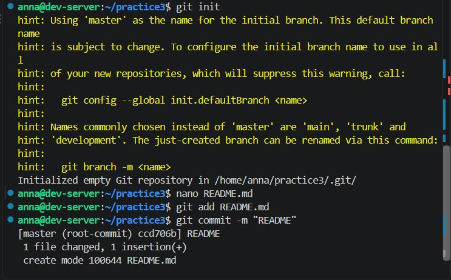

---

## Настройка и проверка SSH-аутентификации
Для безопасного взаимодействия с удаленным репозиторием было настроено SSH-подключение. Успешность аутентификации проверена командой `ssh -T git@github.com`.

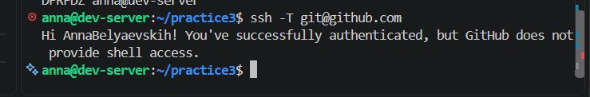

---

## Локальное изменение файла для подготовки конфликта
В файл `README.md` была добавлена строка `Hello, Local World!`, после чего изменения были зафиксированы локальным коммитом (`git commit -am "local hello"`).

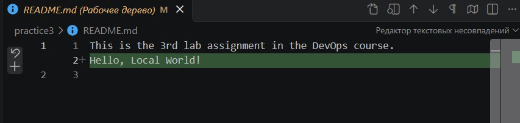
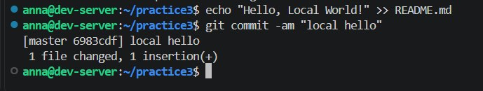

---

## Попытка отправки изменений и отказ сервера
После того как в файл `README.md` на GitHub была добавлена строка `Hello, Remote World!`, попытка отправить локальный коммит командой `git push` завершилась ошибкой (`[rejected]`), так как сервер содержал изменения, отсутствующие локально.

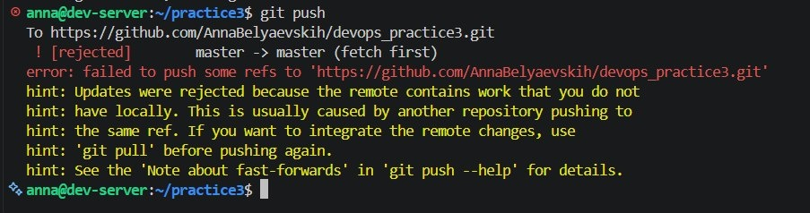

---

## Получение изменений с сервера и обнаружение конфликта
Для получения серверных изменений была настроена стратегия слияния и выполнена команда `git pull`. В результате был зафиксирован конфликт слияния (`CONFLICT (content): Merge conflict in README.md`).

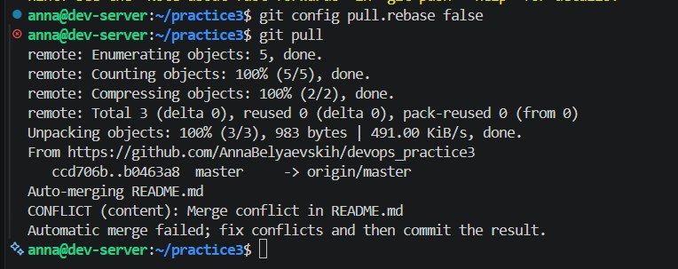

После этого в редакторе открылся файл `README.md` с маркерами конфликта (`<<<<<<< HEAD`, `=======`, `>>>>>>>`).

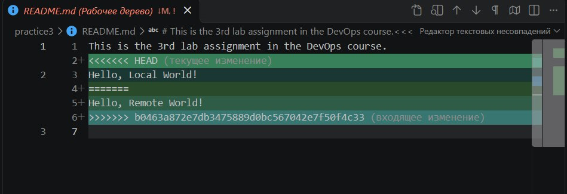

---

## Разрешение конфликта слияния и отправка на GitHub
Файл `README.md` был отредактирован вручную: маркеры конфликта удалены, а строки объединены в итоговый вариант `Hello, Local and Remote Worlds!`.

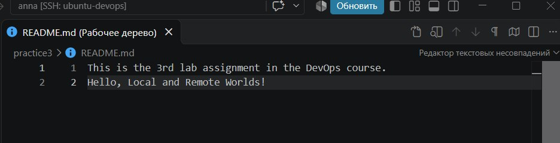

Затем изменения были индексированы (`git add README.md`), зафиксированы коммитом разрешения конфликта (`git commit -m "Resolved merge conflict"`) и успешно отправлены на сервер (`git push`).

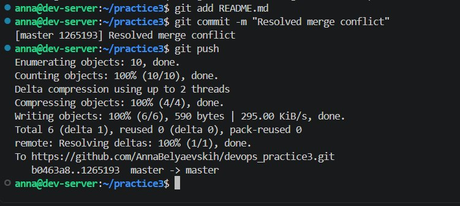

---

## Работа с ветками
Была создана отдельная ветка `FEAT-123` (`git checkout -b FEAT-123`), в которую внесены изменения (`New feature`) и сделан коммит. Ветка была отправлена на GitHub с установкой отслеживания (`git push -u origin FEAT-123`).

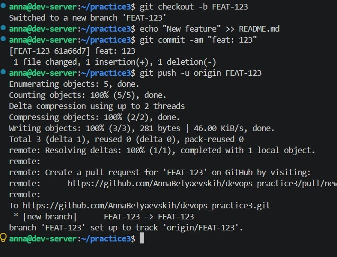

Затем был выполнен переход в ветку `master`, слияние ветки `FEAT-123` методом `Fast-forward` (`git merge FEAT-123`) и отправка изменений в удаленный `master`.

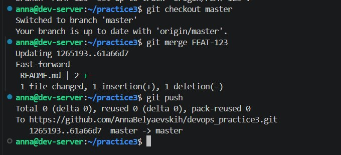

---

## Проверка результатов на GitHub
Результаты слияния и финальное состояние репозитория отображаются на GitHub:

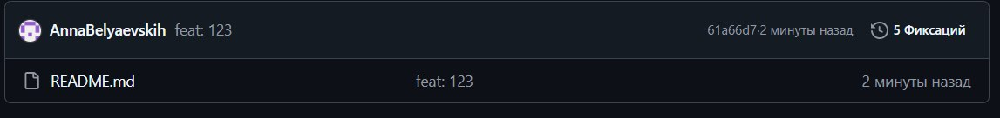

Итоговая история коммитов в репозитории:

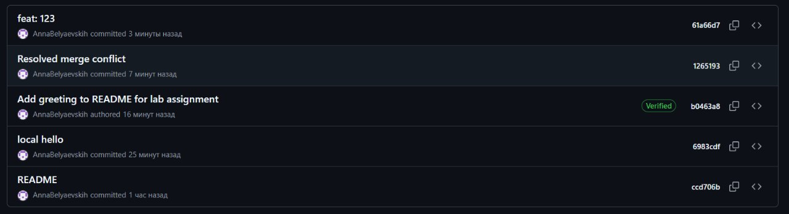